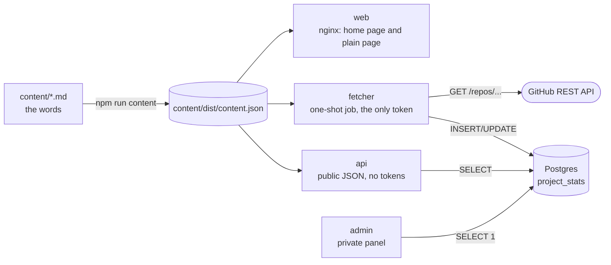

# Architecture

What the repo builds, how the parts fit, and where each is defined. The product side is [`PRD.md`](PRD.md); the chart that deploys it is in [zimmertr/trailhead-helm](https://github.com/zimmertr/trailhead-helm).

## Components

| Folder | What it is | Image |
|---|---|---|
| [`content/`](../content/CLAUDE.md) | The site's words, one Markdown file per place, milestone and project, and the build that checks them and writes `content/dist/content.json` | none: built into the others |
| [`common/`](../common/CLAUDE.md) | What the three Node services share: the redacting logger, the error shape and security headers, settings, the database pool and the migration runner | none |
| [`web/`](../web/CLAUDE.md) | The home page (the still, the signs and the 3D placeholder) and the plain page, written from the content at build time, served by nginx | `ghcr.io/zimmertr/trailhead-web` |
| [`api/`](../api/CLAUDE.md) | The public API under `/api`, with its metrics on a port of their own | `ghcr.io/zimmertr/trailhead-api` |
| [`admin/`](../admin/CLAUDE.md) | The private panel: probes, version, one placeholder page | `ghcr.io/zimmertr/trailhead-admin` |
| [`fetcher/`](../fetcher/CLAUDE.md) | Reads each project's numbers from GitHub into Postgres; its image also runs the migrations | `ghcr.io/zimmertr/trailhead-fetcher` |
| `db/` | `migrations/NNNN_words.sql` and `grants.sql` | shipped in the fetcher image |
| `tools/` | The service bundler, the license collector, and the linter's own package | none |
| `e2e/` | The browser suite and axe, run against the built web image | none |
| `tests/` | Repo-wide checks: locks, notices, Dockerfiles, the CSP's hosts, the styles, the docs | none |

The split by trust is record [0002](architectural-decision-records/0002-four-services-split-by-trust.md): `api` holds nothing worth stealing, `admin` is never public, and only `fetcher` holds a token or calls out.

## Images

Each image builds from the repo root with its Dockerfile in its own folder, because the one lockfile and the content live at the root (record [0009](architectural-decision-records/0009-the-pr-builds-the-images-in-its-own-job.md)). The three Node services are each bundled by esbuild into one file and run on `node:26-alpine` with no `node_modules`; `web` is Vite's output on `nginxinc/nginx-unprivileged:1.30-alpine` (record [0008](architectural-decision-records/0008-services-ship-as-one-bundled-file-on-alpine.md)). Every image:

- runs as uid and gid 10001, the chart's `podSecurityContext`
- works with a read-only root filesystem: the Node images write nothing, and nginx writes only under `/tmp`
- carries `APP_VERSION` and `APP_COMMIT` from the build and answers them at its version path
- ships `LICENSE` and a `third-party-licenses.txt` built from what it bundled

## Database

Postgres 18. One table so far, `project_stats`, defined in [`db/migrations/0001_project_stats.sql`](../db/migrations/0001_project_stats.sql). Migrations are plain SQL run by `node migrate.js` from the fetcher image with the owner's login (record [0010](architectural-decision-records/0010-migrations-are-plain-sql-run-from-the-fetcher-image.md)).

### Database roles

The chart creates three logins, one per service ([trailhead-helm record 0003](https://github.com/zimmertr/trailhead-helm/blob/main/docs/architectural-decision-records/0003-one-database-login-per-service.md)). [`db/grants.sql`](../db/grants.sql) grants each what its service needs, every time the migrations run:

| Role | Service | May |
|---|---|---|
| `trailhead_api` | `api` | read `project_stats`. Later, insert summit register entries |
| `trailhead_admin` | `admin` | connect. Later, update a register entry's status |
| `trailhead_fetcher` | `fetcher` | read, insert and update `project_stats` |

The database suite checks each role can do what this table says and no more.

## Content

`content/src/build.ts` checks every file against `content/src/schema.ts` and writes `content/dist/content.json`; the build stops on any problem and lists them all (record [0011](architectural-decision-records/0011-the-pages-are-written-from-the-content-at-build-time.md)). `web` writes both pages from it at build time, and `api` and `fetcher` bundle it, so the words are written once.
