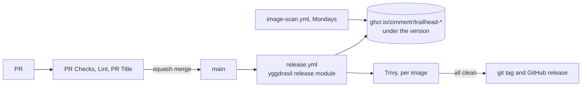

# CI/CD

How a change gets from a PR to a release. The pipeline is zimmertr/yggdrasil's reusable workflows, pinned by commit SHA with the version in a comment; Renovate moves the pins.

## Pull request checks

Each job of the repo's own runs a `make` target, so a red check reruns locally in Docker the same way ([DEVELOPMENT.md](DEVELOPMENT.md)).

| Check | Workflow | Runs |
|---|---|---|
| `PR Title / PR Title` | `pr-title.yml` | yggdrasil's title check: `type(scope): summary` |
| `Lint / actionlint`, `Lint / zizmor`, `Lint / semgrep` | `lint.yml` | yggdrasil's workflow and Dockerfile lint |
| `Static Checks` | `pr.yml` | `make lint` (ESLint and its rules' self-test), `make typecheck`, `make check-openapi` |
| `Unit Tests` | `pr.yml` | `make test`, with line and branch coverage as a sticky PR comment |
| `Database Tests` | `pr.yml` | `make test-db` against a throwaway Postgres, with its coverage as a sticky comment |
| `Image (web)`, `Image (api)`, `Image (admin)`, `Image (fetcher)` | `pr.yml` | hadolint, `make image`, `make smoke`, the image's size, a sticky Trivy comment, and a failure on any fixable Critical or High (record [0009](architectural-decision-records/0009-the-pr-builds-the-images-in-its-own-job.md)) |
| `Browser Smoke & Axe` | `pr.yml` | `make browser-run` against the web image the image job built |
| `Lighthouse Budgets` | `pr.yml` | `make lighthouse-run` against the same image, with the budgets in `.github/lighthouserc.json` |
| `Compose` | `pr.yml` | `make compose-smoke`: `docker-compose.yml` up, checked from outside |

yggdrasil's `repos/zimmertr/trailhead.yml` lists the ones branch protection requires. Renaming a job strands PRs on a check that never reports.

## The release

Every push to main runs `release.yml`, which calls yggdrasil's `release` module with the four images, each built from the repo root with its own Dockerfile, for linux/amd64. In order: GitVersion reads the bump from the squash commit's title; each image is built with `APP_VERSION`, `APP_COMMIT` and `APP_BUILT_AT`, an SBOM and provenance, and pushed to `ghcr.io/zimmertr/trailhead-<service>` under the version only; Trivy scans each; and only when every scan passes, the commit is tagged and an immutable GitHub release is published. The checks it reports are `Release / Version`, `Release / Build & Push (zimmertr/trailhead-<service>)`, `Release / Scan Pushed Image (zimmertr/trailhead-<service>, linux/amd64)` and `Release / Tag and Release`.

Nothing deploys yet. The release passes no `deploys` and no `charts`: deploying waits until TJ picks the hostnames, and the chart releases from zimmertr/trailhead-helm. When it does, the release adds a deploy bump to Kubernetes-Manifests that pins each image by digest, as Bluebird's does.

A release that fails part way is finished with "Re-run failed jobs", or by releasing again from main. Fix forward: never push or move an image tag by hand.

## The weekly scan

`image-scan.yml` runs yggdrasil's `image-scan` module every Monday and on demand, over the latest release's four images. It sends the findings to the Security tab and fails only on a fixable Critical or High. It fails until the first release exists.

## Secrets

None. Every job uses its own `GITHUB_TOKEN`: the release pushes to GHCR with it, and the PR jobs use it for their sticky comments. When deploys arrive, the release needs `GH_PAT` (contents and pull-requests write on Kubernetes-Manifests) as its `deploy-token`, as Bluebird's does. The fetcher's GitHub token lives in the cluster, in the `trailhead-fetcher-tokens` Secret, never in GitHub Actions.
