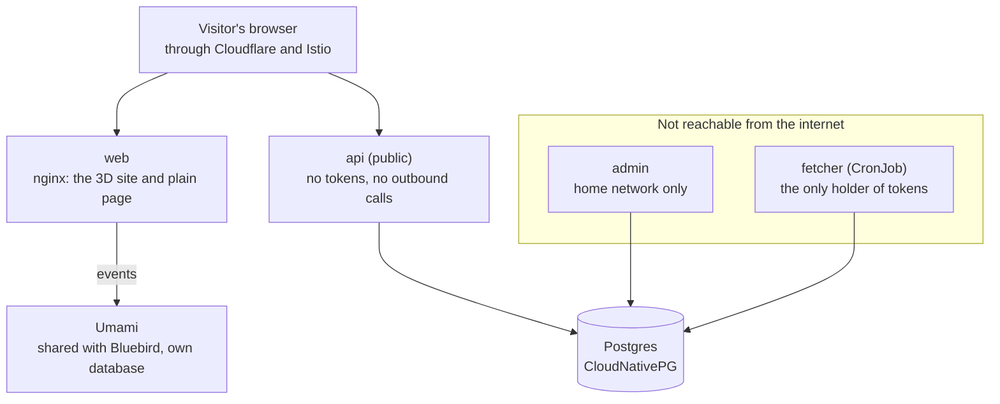

# Product requirements

TJ signed this off on 2026-11-12. It is the plan the site is built to. A decision that changes it gets a record under [`architectural-decision-records/`](architectural-decision-records/README.md), and this page is corrected in the same PR.

## 1. Project overview

Trailhead is tjzimmerman.com rebuilt as one low-poly 3D mountain world that a visitor runs and climbs through to learn about TJ. It replaces the static page in zimmertr/Personal-Website, which is archived by the same pull request that creates zimmertr/trailhead.

The visitor starts at the Trailhead, a subalpine meadow with three destinations in view, and picks one:

| Place | What it holds | How he gets there |
| --- | --- | --- |
| About Lake | Who TJ is, what he does in the mountains, a personal note | A trail run through mossy rainforest to an alpine lake |
| The Stack | Platform Engineering, Site Reliability Engineering, Software Engineering, then the resume | A roped big-wall rock climb |
| Sideproject Spires | Six personal projects, one spire each | A solo glacier climb from a base camp |

It is for anyone who looks TJ up: recruiters, engineers, friends. It has to be fast, good-looking, responsive and full of things to find. A plain illustrated page carries the same words for anyone who wants to skip the 3D.

The name "About Lake" is a placeholder. TJ wants a name that points at him without using his name.

## 2. Core requirements

These hold for every part of the site. Each came from TJ's review of the Round 3 prototypes or from the planning interview on 2026-11-12.

1. **One world.** Every place sits in one flat world: the Trailhead meadow on a rise, and in front of it from left to right the forest and About Lake, The Stack, and Sideproject Spires. It holds those and nothing else. The visitor is on rails. Every camera follows a route or stands at a fixed view, so the world is finished only where a camera looks. A mountain seen from the Trailhead is the same mountain up close, and an object keeps its place and its look everywhere.
2. **Low-poly throughout.** No contour lines, no separate realistic style. Places differ by colour and environment.
3. **Nothing plays by itself.** The site opens at the Trailhead and waits. Background motion and a slow camera drift are fine. The character and the route never move until the visitor acts. Audio can begin playing, animals can move about the scene. Plants can sway in the wind.
4. **Movement is short.** About 4 seconds between milestones and about 6 seconds from the Trailhead to a section. The wall and the spires stand far enough off to be seen whole, so those two approaches are travelled at several times a run with the camera standing off to watch. Any trip can be skipped with a click or a key.
5. **One set of controls, three ways of moving.** He runs to About Lake, rock climbs The Stack, and travels over snow, glacier and ice on the Spires. What stays the same is how the visitor drives him: one start and stop toggle, one timeline that scrubs both ways, one camera with one drag speed, one set of keys.
6. **The camera never loses him.** Dragging looks around. Any character movement puts the camera back behind him at once.
7. **He touches the ground.** Feet, hands and tools meet the surface under them. Steep ground is avoided except where the route is a climb. Interactions with the terrain must be realistic and human-like. Near-vertical terrain should be slow moving, involve front pointing crampons and progressing by swinging ice tools and climbing. Not "running" up 80 degree snow.
8. **A way home is always on screen.** Every route is a loop back to the Trailhead, and the trail map reaches any place from anywhere.
9. **The words are written once.** The 3D cards, the plain page and the API all read the same content files.
10. **Third person.** The site talks about TJ, never as him.
11. **Favour looks.** Built for good graphics cards: dense forest, long views. Weaker devices get less detail, then the plain page.
12. **Always starts in Day.** Dusk is a toggle and is remembered.
13. **Observed from day one.** Visits, what people use, where they leave, session length, errors, frame rate, CPU and memory are all measured before the site goes live.
14. **The device's reduce-motion setting is not honoured.** TJ's decision, 2026-11-12. The plain page stays one click away in the trail map.

## 3. Core features

### The Trailhead

A Rainier-style subalpine meadow thick with wildflowers, on a rise, with the three destinations in view from left to right: the forest and About Lake, The Stack, Sideproject Spires.

- Heading "TJ Zimmerman" on one line, then: "is a principal platform engineer based out of Seattle, WA. When he's not playing in the mountains, he's usually hacking on computers. Choose a destination to learn more!"
- Three signs: "Run to About Lake to learn more about TJ", "Climb The Stack to learn more about his skills", "Climb the Sideproject Spires to see some of his personal projects".
- Picking a sign sends him off at once. The camera follows along the real trail for about 6 seconds and lands at the first milestone. No card in between.
- While he waits, the camera drifts slowly from one destination to the next. Drag looks the full circle. Behind the visitor: TJ's two cats, a long-hair tortie and a long-hair Nebelung, playing with each other.
- A kiosk holds the trail conditions board: running version, deploy time, uptime, "all trails open".
- A flag stands on each destination the visitor has finished, and his footprints stay on that trail.

### About Lake

A run through dense, mossy rainforest (Olympic National Park) up to an alpine lake under a huge sweeping peak (Colchuck and Dragontail as the reference). The trail rounds the lake and comes home by another path.

| Milestone | Card comes out of | Links |
| --- | --- | --- |
| Who TJ is | A trail sign | LinkedIn, GitHub, Resume |
| In the mountains | The map from his pocket | Strava, Peakbagger, Mountain Project |
| A personal note | His trail journal, opened on a shore boulder | All five profiles |

Along the way: elk grazing, a banana slug he jumps, a bear watching from the trees where he can't see it, and a marmot sunbathing on a rock above the lake. TJ writes the personal note later, fill in with lorem ipsum for now.

### The Stack

A Yosemite-style big wall in brown tones, seen from a close camera behind the climber. He leads on a rope that trails out of frame, with no partner shown. One route, three pitches, a ledge between each where the card opens, then the summit, then a rappel.

| Pitch | Climbing | The moment | Card comes out of |
| --- | --- | --- | --- |
| Platform Engineering | Crack | The gear he places stays behind as a line of bolts and a fixed rope | The rack on his harness, each piece a tool |
| Site Reliability Engineering | Face | A hold breaks, he falls a body length, the rope catches him | His watch, showing the wall like a dashboard |
| Software Engineering | Roof | The next holds glow as suggestions. He follows most and skips one that leads nowhere | The guidebook's route drawing |
| Summit |  | He plants the flag | Resume and LinkedIn |

Each skill card is two or three sentences and the tools. No numbers and no employers. Birds on the wall, a pika in the talus at its foot.

### Sideproject Spires

A glaciated North Cascades massif of aiguilles, one per project, climbed solo. They can be spires, towers or sub-peaks. What matters is that each stands apart from the others, not that it is jagged. Arriving at base camp, the camera rises into an orbit of the whole massif with each spire named. Drag spins it, click a spire and he sets off. Every route starts at base camp and ends with a glissade back to it, where the orbit resumes. Mountain goats watch.

| Spire | The route | On top | Click it and |
| --- | --- | --- | --- |
| Bluebird Forecast | A windy knife-edge snow ridge that clears to blue sky | A weather station | A bluebird circles him and flies off |
| TJs-Kubernetes-Service | Through the icefall, seracs standing like server racks | A hut with the rack showing red | He hits it, it goes green, and low-poly stand-ins for the tools burst out |
| hevy-garmin-sync | A steep ice pitch with two tools and crampons | A weight bench | He bench presses |
| trailhead | A snow bridge collapses under him and he jumps the crevasse | A brass survey marker | The whole world shows its triangle mesh for a few seconds, with a triangle and frame-rate readout |
| yggdrasil | A ladder across the bergschrund | The world tree | The squirrel Ratatoskr runs up to the eagle on top, lighting nine lights as it passes |
| Kubernetes-Manifests | Marker wands through a whiteout | A cairn | He knocks a stone off and the cairn puts it back |

Every project card shows the same facts: stars, latest release and its age, language and license. The TJs-Kubernetes-Service card also tells how this site runs at home (Proxmox, Terraform, Talos Linux, Kubernetes, Istio, MetalLB) and links the hardware list. A new project is a new content file; it gets a flag on top until a route and an egg are designed for it.

### Across the whole site

- **Timeline.** A thin line along the bottom with a dot per milestone and a marker for him. Click a dot to jump, drag to scrub, play and pause at the left, the way home at the right.
- **Milestones.** He stops in about a third of a second, the card opens, one press sends him on.
- **Trail map.** The menu, titled "Trailhead", is a park-brochure map of the same world. Every milestone is a dot that travels there. A side column holds Resume, the five profile links, "Read as a page" and settings. Small features carry joke names (Scope Creep Glacier, Tech Debt Crevasse, Merge Conflict Col), which also appear on small signs in the world.
- **Addresses.** Every milestone has its own, such as `/sideproject-spires/bluebird`. The link opens there with the card open, and the back button steps through places visited.
- **Plain page.** One scrolling page with every card's text and links, illustrated with stills from the world. Also what crawlers and browsers without WebGL get.
- **Loading.** The page opens on a still of the Trailhead with the intro readable and the signs working as links. The 3D replaces the still in place.
- **Keys.** Space starts and stops him. Left, right, A and D jump between milestones. Up or W starts, down or S stops. M or Esc opens the trail map. T switches Day and Dusk.
- **More to find.** A cold plunge at the lake. A snack break if he is left standing for a minute. Sasquatch, once per visit. A Dusk-only sky. A message in the browser console. The 404 page as "off route" in a whiteout.

## 4. Core components

The 3D site is built from six parts that every place shares. Round 3 built each scene as its own small simulation with its own controls, and most of TJ's complaints trace back to that.

| Part | What it does | The rule it follows |
| --- | --- | --- |
| World | One flat world holding the meadow, the forest, the lake basin, the wall and the spires, in small faces where a route or a camera goes and big ones beyond | A place is built once and seen from everywhere |
| Routes | The paths through the world, each a loop from the Trailhead with milestones along it. The Spires route is a hub at base camp with a spoke per spire | A route is data, not code |
| Progress | One number per route: how far along it he is. The timeline, the scroll wheel, the keys and the run toggle all change only this number | His position, his pose and the camera are all computed from it, so scrubbing backwards is free and nothing can lag |
| Character | A low-poly, faceless TJ: short brown hair, short beard, sunglasses. His pose comes from the progress number and the ground under him | Hands, feet and tools reach for real holds and steps |
| Camera | One rig for every place: a follow view, a close view for the wall, an orbit for the massif | Drag looks, movement snaps back |
| Cards and content | Markdown files, one per place, milestone and project, with fields on top and prose below. A build step turns them into one checked data file | The 3D cards, the plain page and the API read the same file |

His kit changes by place:

| Place | Kit |
| --- | --- |
| Trailhead and About Lake | Black quarter tights, yellow sun hoody, salmon running vest, sunglasses, baseball hat |
| The Stack | Yellow pants, yellow sun hoody, yellow climbing pack, green helmet |
| Sideproject Spires | Soft shell pants, green puffy, green helmet, ice axe, mountaineering pack |

The character is driven by code first. Where running, the jump or the glissade still look wrong, those moves use clips from free animation libraries, after a license check.

## 5. App and user flow

A first visit runs like this:

1. The page opens on a still of the Trailhead. The intro is readable and the three signs work as plain links.
2. The 3D world replaces the still in place. The meadow moves, the camera drifts a little, and he waits.
3. The visitor looks around, or clicks a sign.
4. He sets off down that trail. The camera follows for about 6 seconds and lands at the first milestone, where he stops and the first card opens.
5. One press sends him on. About 4 seconds later he stops at the next milestone. The visitor can also drag the timeline, scroll, or jump from the trail map.
6. At the top of the route the visitor plants the flag.
7. The last leg of the timeline is the way home: the loop round the lake, the rappel, or the walk out from base camp.
8. Back at the Trailhead from a new direction, the finished destination now flies its flag.

The Spires add one loop inside step 5: orbit at base camp, pick a spire, climb it, glissade back to camp, orbit again.

Three other ways in:

- **A milestone link** opens the world with him already standing at that milestone and its card open.
- **"Read as a page"**, or a browser without WebGL, shows the plain illustrated page.
- **A wrong address** lands him off route in a whiteout, with one wand and a sign back to the Trailhead.

## 6. Tech stack and services

Trailhead is four small services split by trust, one database, and Umami beside them. TJ chose this over a single backend on 2026-11-12.

The browser reaches only `web` and `api`. `admin` and `fetcher` have no route from the internet, and `api` holds nothing worth stealing.

| Choice | Decision |
| --- | --- |
| 3D | three.js, flat-shaded low-poly |
| Language | TypeScript everywhere: site, api, admin, fetcher |
| Build | Vite for the site. Everything builds, runs and tests in Docker |
| Content | Markdown files with YAML fields, compiled at build time into one checked data file |
| Typeface | National Park |
| API address | The same site, under `/api`, as Bluebird does |
| Database | Postgres from CloudNativePG, already on the cluster |
| Repo | zimmertr/trailhead holds the services, a folder and an image each. zimmertr/trailhead-helm holds the Helm chart, published as an OCI artifact, as bluebird-helm does |
| Deploy | Argo CD from zimmertr/Kubernetes-Manifests, Argo Rollouts, checked before any visitor reaches a new version |
| Previews | A running copy per pull request on a home-network hostname, as Bluebird has |
| CI | zimmertr/yggdrasil's shared workflows |
| License | PolyForm Noncommercial 1.0.0, public repo |

### How every service runs

Each service stays up through the loss of a node, and no new version reaches a visitor before it has been checked.

- **Replicas.** `web` and `api` run three replicas and `admin` one, since only TJ uses it. The replicas of the two public services are spread across the three worker nodes, and a PodDisruptionBudget on each keeps a node drain from taking it down.
- **Database.** Postgres is a CloudNativePG cluster of three instances with automatic failover, as Bluebird's is.
- **Progressive delivery.** `web`, `api` and `admin` are Argo Rollouts. A new version starts beside the old one with no visitor traffic, and scripted checks run against it: it reports the expected version, its health check answers, the key pages and the API contract respond correctly, and for `web` a headless browser loads the world and confirms the first frame draws with no errors. Traffic moves only after every check passes. A failed check aborts the rollout and the old version keeps serving.
- **No judging on live traffic.** The site is idle most of the time, so a canary that watches real requests would measure nothing. Every gate is a check the rollout runs itself. Bluebird already works this way with its `version-check` and `api-test` analyses.
- **The fetcher** is a CronJob, not a Rollout. One run at a time, with retries. A failed run keeps the last good numbers, and repeated failures raise an alert.
- **Resources and probes.** Every container sets CPU and memory requests and limits, taken from measurements. Every service has startup, readiness and liveness probes.
- **Images.** One image per service on a minimal base. Each runs as a non-root user with a read-only root filesystem, every Linux capability dropped, no privilege escalation, the default seccomp profile and no service account token.
- **Least privilege between services.** Each service has its own database role with only the statements it needs: `api` reads numbers and approved entries and inserts new entries, `admin` changes an entry's status, `fetcher` writes numbers. Istio policies allow only the calls the diagram shows.

Observability is part of the foundation, not a later task:

- **Umami**, self-hosted, no cookies: visits, sessions, and one event per milestone reached, map opened, egg found and section left. Funnels answer where people bail out.
- **Errors and performance** go out as Umami events: the error message, browser and graphics card, plus frame-rate and load-time samples.
- **Grafana** shows error rate and frame rate beside CPU and memory for each service. **Alertmanager** warns when the error rate jumps.
- **The trail conditions board** at the Trailhead reads the same numbers a visitor is allowed to see: version, deploy time, uptime.

Bluebird Forecast gets the same Umami: https://github.com/zimmertr/bluebird/issues/929.

## 7. Implementation plan

The work runs in six phases, and TJ signs off between them.

1. **Repo.** Done on 2026-11-12. https://github.com/zimmertr/yggdrasil/pull/105 created zimmertr/trailhead and archived zimmertr/Personal-Website, and https://github.com/zimmertr/yggdrasil/pull/109 created zimmertr/trailhead-helm.
2. **Foundation.** License, README, docs set, this PRD as `docs/PRD.md`, the first decision records, the epic and its issues. Then the build in Docker, CI on yggdrasil's workflows, all four services deployed as skeletons with a health check and a version endpoint, the database, the Helm chart in its own repo (zimmertr/trailhead-helm, GPL-3.0), per-PR previews, a home-network copy of main, Umami on the cluster, and the Grafana dashboard and alert. It ends with the foundation checklist report.
3. **Round 4 prototype.** Done on 2026-11-13, as an artifact TJ reviewed. It built the world as a small planet three times, and TJ dropped the planet for a flat world on rails ([record 0014](architectural-decision-records/0014-the-world-is-flat-and-the-visitor-is-on-rails.md)). Its slice carries into phase 4: the Trailhead with the three destinations in view, the trip to About Lake, the timeline, the run toggle, scrubbing, the camera and the cards. Its two movement studies were not built and move into phase 5.
4. **About Lake and the shared parts, finished.** The slice becomes the real thing: all three milestones, the trail map, addresses, the plain page, the loading still, the content files, analytics events.
5. **The Stack and Sideproject Spires**, built on the same parts, in parallel where it helps. Each starts with its movement study: the fall and the catch on The Stack, and the ice pitch, the crevasse jump and the glissade on the Spires. The api and fetcher, running since the foundation, get their first real job here: the project numbers.
6. **Cut-over.** When everything in the MVP works, tjzimmerman.com switches to trailhead straight away. Nobody depends on the old site.

The MVP is phases 1 to 6. Each of these comes after it and gets its own issue when the repo exists:

| After the MVP | What is already decided |
| --- | --- |
| Summit register | A hidden fourth place for visitors who finish all three. Plain text, rate limited, no email, kept forever, each entry approved by TJ in the admin panel |
| Admin login | The panel starts as home network only with no login. Auth is added afterwards |
| Sound | On by default with a mute control. Ambience per place, footsteps and gear, small sounds for cards and flags. No music. Starts on the first click or key press |
| Strava and Peakbagger numbers | Miles run, workouts done, peaks climbed, on the "In the mountains" card. Fetched by the fetcher |
| Resume updates | The Resume repo's CI raises a PR here with the new PDF. It never merges itself |
| Phone review | Layout and touch are checked on a real phone once previews run on the cluster |

## 8. The interview's choices

Every choice the project-start process asks about has an answer, and each switches a standard on.

| Choice | Answer | What it switches on |
| --- | --- | --- |
| Who uses it, and how | People in a browser, plus a small public API | The UI standards, `docs/STYLES.md`, Lighthouse CI, `docs/API.md` and the API contract |
| Reached from the internet by strangers | Yes | Per-client rate limits, client identity only from the proxy, security headers |
| Themes | Day and Dusk. Always starts in Day, with its own toggle, remembered | Tokens per theme, each measured for contrast |
| Does a link carry what the visitor is looking at | Yes, one address per milestone | Shareable state |
| One service or several | Several: web, api, admin, fetcher | 12-factor services, each its own deployable |
| One repo or several | Two, trailhead and trailhead-helm, both under the personal account | No organization |
| Where it runs | TJ's Kubernetes cluster | GitOps through Argo CD and Kubernetes-Manifests |
| Long-running and user-facing | Yes | Helm chart, ApplicationSet, Argo Rollouts canary, releases bump the chart |
| Database | Yes, Postgres | SQL tested against a throwaway database in a container |
| Container image | Yes, one per service | The full image pipeline: build and scan on PRs, release scan, weekly re-scan, attestations |
| License | PolyForm Noncommercial 1.0.0 | `LICENSE`, and `NOTICES.md` for three.js, the typeface and any animation clips |
| Public or private | Public | GitHub's free security features |
| Upstream data and services | GitHub's API now. Strava and Peakbagger later | `docs/DATA.md` with each provider's terms |

TJ said on 2026-11-12 that the process is general purpose and its rules can be set aside where that serves this project. Two are:

- **"Use an existing UI framework such as Material."** A 3D world has no use for a component library. The few flat parts (cards, timeline, trail map, plain page) share one small set of styles, written down in `docs/STYLES.md`.
- **Honouring the device's reduce-motion setting.** TJ decided to ignore it. The plain page is the way out for anyone who needs one.

One more needs a decision before the foundation is checked: the standards expect measured contrast and Lighthouse scores, which apply to the flat parts and the plain page but mean little for a 3D canvas. The plan is to hold the flat parts and the plain page to them and to measure the 3D by frame rate and load time.

## 9. Open items

Six things are not settled. The first four are TJ's to do or decide, and the last two are answered as the places are built.

- [ ] A final name for About Lake. It keeps this one for now.
- [ ] The personal note at the lake, in TJ's words.
- [ ] A photo or two of TJ in each kit, to tune the low-poly figure.
- [ ] The list of about ten joke names for the map, for TJ to strike from.
- [ ] Does the code-driven character look right running, jumping and glissading, or do those moves need animation clips?
- [ ] The look of the rainforest, the Yosemite wall and the aiguilles, worked on until it is right.
