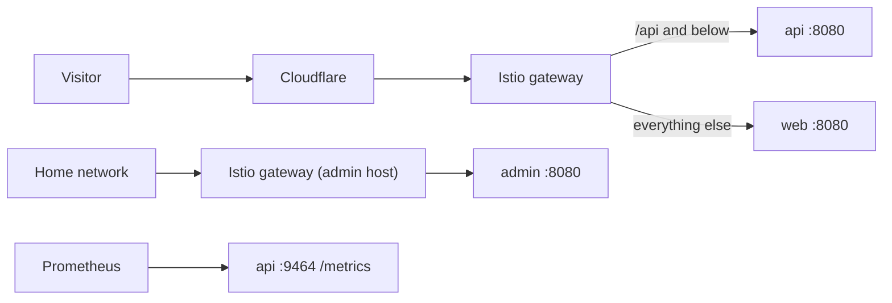

# Traffic

How requests reach the services, and every call they make.

## Inbound

The chart (zimmertr/trailhead-helm) owns the routes: `web` on every path of the site's hosts, `api` on `/api` and below, and `admin` only on its own home-network host and Gateway. Istio policies let only the gateway reach the three, and refuse any request to `admin` that carries `CF-Connecting-IP`, the mark of a request from the internet. The metrics port is never on a Service.

### Client identity

The API's rate limit counts each client by the `CF-Connecting-IP` header alone (`clientBucket` in [`api/src/client.ts`](../api/src/client.ts), record [0013](architectural-decision-records/0013-client-identity-comes-from-cf-connecting-ip-alone.md)): an IPv4 address as itself, an IPv6 address by its /64, and a request without a valid address in one shared bucket. The socket address is the gateway's and `X-Forwarded-For` is the caller's to write, so neither is read. The gateway must strip `CF-Connecting-IP` from any request that didn't come through Cloudflare. No service logs a client address.

### Headers

Every response carries a content security policy, `nosniff`, `X-Frame-Options: DENY`, a referrer policy and the cross-origin isolation headers, errors and 404s included: `web` from [`web/security-headers.conf`](../web/security-headers.conf), `api` and `admin` from `securityHeaders` in [`common/src/http.ts`](../common/src/http.ts). The web policy lists exactly what the pages load: their own scripts, styles, fonts and images, and requests back to the site. `tests/csp.test.ts` fails on a host in `web/src` the policy hasn't classified. HSTS is set where TLS ends, at Cloudflare.

## Outbound

| From | To | Timeout | Retries |
|---|---|---|---|
| `fetcher` | `api.github.com`, two reads per project ([DATA.md](DATA.md)) | 10 seconds a read (`REQUEST_TIMEOUT_MS`) | none in the run: a failed repo keeps its last numbers, and the CronJob retries the whole run (`backoffLimit` in the chart) |
| `api`, `admin`, `fetcher` | Postgres, in the cluster | connect and statement timeouts in [`common/src/db.ts`](../common/src/db.ts) | none: a failure answers `503`, or fails the run |

`api` and `admin` make no call outside the cluster. The browser reaches only the site itself; Umami, when it arrives, is the first host the policy will need to list.
