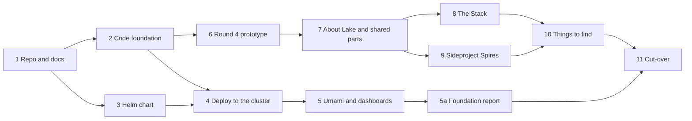

# Issues 8 and 14 to 17 before the rewrite of 2026-11-16

TJ decided on 2026-11-16 that the pixel world is the site to ship, and round 5 item A0c rewrote these five issues for it. This is their text as it was, title, labels and body, so nothing is lost.

## #8: Build trailhead to its MVP and switch tjzimmerman.com to it
LABELS: enhancement,P1,8d20dfc8-98bd-4ded-b290-e61cac2c390c,content,security,site,services,infra

## Summary

tjzimmerman.com is a static page, and its replacement, a small 3D world a visitor runs and climbs through, exists only as a plan. This issue tracks the eleven remaining tasks that take trailhead from an empty repo to the live site, in the order they depend on each other.

---

## Problem

The old site is one static page served from an archived repo. zimmertr/trailhead holds `docs/PRD.md`, signed off by TJ on 2026-11-12, and seven decision records. Nothing in it runs.

The PRD's section 7 gives the build as six phases. Nothing tracks those phases as work someone can pick up, with what blocks what.

## Proposed Solutions

Settled by TJ on 2026-11-12:

- Few, large tasks. Each task is one issue and one PR, and its sub-steps are checkboxes inside the issue. His words: "I prefer delivering in fewer PRs where possible."
- The foundation comes first, then one prototype round aimed at feel, then the places.
- On 2026-11-13, after that prototype round, he dropped the small planet and the Konami code for a flat world on rails (record 0014, in https://github.com/zimmertr/trailhead/pull/24). His words: "The first iterations of a diorama seemed better."
- tjzimmerman.com switches to trailhead as soon as the whole MVP works.
- This plan was filed without his review. His words: "File it, I'll adjust after."

## Implementation Plan

Each item is one task. Its ID is its number, and "needs" lists the IDs that must be done first.

**Foundation**

- [x] **1. Repo, license, README, PRD and decision records.** Needs: nothing. Done in https://github.com/zimmertr/trailhead/pull/7.
- [ ] **2. Code foundation**: the four services as skeletons, the content pipeline, tests, images, CI and release. Needs: 1. https://github.com/zimmertr/trailhead/issues/9
- [ ] **3. Helm chart** in zimmertr/trailhead-helm. Needs: 1. https://github.com/zimmertr/trailhead/issues/10
- [ ] **4. Deploy to the cluster**: a home-network copy of main and a preview per pull request. Needs: 2, 3. Blocked on hostnames. https://github.com/zimmertr/trailhead/issues/11
- [ ] **5. Umami, the Grafana dashboard and the alert.** Needs: 4. Blocked on a hostname. https://github.com/zimmertr/trailhead/issues/12
- [ ] **5a. Foundation checklist report.** Needs: 2, 3, 4, 5. Run every line of `references/done.md` in the `initialize-project` skill against the live repos and their runs, fix what fails, and send TJ each line's mark and evidence. It has no issue of its own.

**Prototype**

- [ ] **6. Round 4 prototype**: the world as a small planet, built three times and dropped for a flat world on rails. Needs: 2. Its playable slice carries into task 7, and the movement studies move to tasks 8 and 9. https://github.com/zimmertr/trailhead/pull/24 closes it. https://github.com/zimmertr/trailhead/issues/13

**The places**

- [ ] **7. About Lake, the Trailhead and the parts every place shares.** Needs: 6 and TJ's sign-off of it. https://github.com/zimmertr/trailhead/issues/14
- [ ] **8. The Stack.** Needs: 7. https://github.com/zimmertr/trailhead/issues/15
- [ ] **9. Sideproject Spires**, with project numbers from `api` and `fetcher`. Needs: 7. https://github.com/zimmertr/trailhead/issues/16
- [ ] **10. The things to find across the site.** Needs: 7, 8, 9. https://github.com/zimmertr/trailhead/issues/17

**Go live**

- [ ] **11. Cut-over**: tjzimmerman.com serves trailhead. Needs: 4, 5, 5a, 8, 9, 10. https://github.com/zimmertr/trailhead/issues/18

**After the MVP**

- [ ] **12. Resume updates arrive as a pull request.** Needs: 11. https://github.com/zimmertr/trailhead/issues/19
- [ ] Summit register: https://github.com/zimmertr/trailhead/issues/3
- [ ] Admin login: https://github.com/zimmertr/trailhead/issues/4
- [ ] Sound: https://github.com/zimmertr/trailhead/issues/5
- [ ] Strava and Peakbagger numbers: https://github.com/zimmertr/trailhead/issues/6

## Acceptance Criteria

- Tasks 2 to 11 are closed, each by one merged PR, or by one per repo where a task spans repos.
- TJ has seen the foundation checklist report.
- TJ has signed off the feel of the flat world before task 7 merges.
- https://tjzimmerman.com serves trailhead.
- Visits, errors, frame rate, CPU and memory are measured before the switch (requirement 13 in `docs/PRD.md`).
- Every PR passed the repo's gates in the `CLAUDE.md` Issues section.

## Notes for an AI agent

- Take the lowest-numbered open task whose needs are all closed. Tasks 8 and 9 can run at the same time.
- One task is one PR. Do not split a task into several PRs or file its sub-steps as issues.
- Tick a task here when its PR merges.
- Everything builds, runs and tests in Docker.
- Words on the site live only in the content files, in third person. New user-facing text needs TJ's approval before it ships.
- `api` holds no tokens and makes no outbound calls. `admin` is never reachable from the internet. Only `fetcher` holds tokens.
- Never run a command that changes the cluster. Tasks 4, 5 and 11 deploy through zimmertr/Kubernetes-Manifests.

## Notes for a human

- Blocked on you: the home-network hostnames. Tasks 4 and 5 cannot start without them, and task 11 waits on both.
- Yours to adjust: the split into tasks, their order and their priorities. Claude Code chose all three.
- Tasks 2 and 3 were started by subagents on 2026-11-12.
- The largest risk was task 6. One small planet could not hold full-size mountains, so record 0014 replaces record 0001 with a flat world on rails.
- You have seen the flat world only as an artifact. A real build needs the preview hostname.
- Provenance: `docs/PRD.md` section 7 and the planning session of 2026-11-12.

## #14: About Lake and the parts every place shares are not built
LABELS: enhancement,P1,8d20dfc8-98bd-4ded-b290-e61cac2c390c,content,site

## Summary

After the prototype, the Trailhead and About Lake exist only as a rough slice, and the parts every place needs are unfinished. After this task the first destination is complete end to end, with the timeline, cards, trail map, addresses and plain page that the other two destinations reuse.

---

## Problem

The prototype settled the shape of the world, flat and on rails (record 0014), and leaves most of the product unbuilt. `docs/PRD.md` section 3 specifies the Trailhead, About Lake and the parts shared across the site. None of it exists in finished form.

This task starts from the prototype's flat world, which https://github.com/zimmertr/trailhead/pull/24 ports into `web/src/world/`.

## Proposed Solutions

Settled by TJ on 2026-11-12, all in `docs/PRD.md`:

- The copy at the Trailhead and its three signs, in third person.
- About Lake's three milestones, and the object each card comes out of.
- The timeline as a thin line with a dot per milestone.
- The trail map as the menu.
- One address per milestone.
- The plain page as one illustrated page.
- A still of the Trailhead on load that the 3D replaces in place.

## Implementation Plan

Folder names are the planned ones from `docs/PRD.md`. Check them against the repo before you start.

1. Finish the Trailhead: the meadow, the heading and intro on one line each, the three signs, the full-circle look with TJ's two cats playing behind the visitor, and the kiosk with the trail conditions board.
2. Finish the trip to About Lake: the rainforest, the lake under its peak, the loop home, the elk, the banana slug he jumps, the bear in the trees and the marmot above the lake.
3. Build the three milestones and their cards: the trail sign, the map from his pocket and the trail journal.
4. Finish the timeline, the keys from `docs/PRD.md` section 3, and scroll as scrubbing.
5. Build the flag the visitor plants, the footprints that stay, and the memory of both in the browser.
6. Build the trail map with a dot per milestone and the side column of links and settings.
7. Give every milestone its address, opening with its card open, with the back button stepping through places visited.
8. Build the plain page with stills rendered from the world, and serve it where WebGL is missing.
9. Build the loading still and the hand-over to the 3D.
10. Build Day and Dusk, starting in Day and remembered.
11. Send the analytics events for each milestone, the map and each section left.

## Acceptance Criteria

- A first visit can go from the opening still to About Lake's last card and back to the Trailhead with one press per milestone.
- A link to `/about-lake/` plus a milestone opens with him standing there and the card open.
- The plain page shows every card's words and links, and a browser without WebGL lands on it.
- The intro and the signs are readable and clickable before the 3D has loaded.
- A finished destination shows its flag from the Trailhead after a reload.
- Every word on screen comes from the content files.
- The PR states load time and frame rate before and after.
- Every required check passes.
- New behaviour arrives with its tests, and coverage is reported on the PR.
- The docs page that owns the topic changes in the same PR, and the README changes only to stay accurate.

## Notes for an AI agent

- Everything builds, runs and tests in Docker. Use the `Makefile` targets once they exist.
- Words on the site live only in the content files, in third person. New user-facing text needs TJ's approval before it ships.
- The personal note at the lake stays lorem ipsum until TJ writes it.
- Build each shared part once, for all three destinations. The Stack and the Spires must not need their own timeline, camera or cards.
- The device's reduce-motion setting is not honoured (record 0005). Do not add a second way of moving.
- The exact address for each milestone is yours to propose. Keep it stable once it ships.

## Notes for a human

- Task 7 of the build plan, https://github.com/zimmertr/trailhead/issues/8. Starts from https://github.com/zimmertr/trailhead/pull/24, which closes https://github.com/zimmertr/trailhead/issues/13.
- Yours to decide: the personal note, the final name for About Lake, and the joke names for the map, which the things-to-find task uses.
- Yours to sign off: the feel of the flat world. You have seen it only as an artifact, and a real build needs the preview hostname.
- This is the largest task in the plan, because it carries the parts the other places share.
- Provenance: `docs/PRD.md` sections 3, 4 and 5.

## #15: The Stack is not built
LABELS: enhancement,P2,8d20dfc8-98bd-4ded-b290-e61cac2c390c,content,site

## Summary

The second destination, the climb that shows TJ's professional skills, does not exist. After this task a visitor can climb The Stack's three pitches to the summit, read a card on each ledge, and rappel home.

---

## Problem

`docs/PRD.md` section 3 specifies The Stack: a Yosemite-style big wall in brown tones, seen from a close camera behind a roped climber, with one route of three pitches. The prototype built the wall and the trip to its foot. Nobody climbs it yet.

## Proposed Solutions

Settled by TJ on 2026-11-12:

- One route, three pitches, then a summit card with the resume and LinkedIn.
- The pitches are Platform Engineering (crack), Site Reliability Engineering (face) and Software Engineering (roof).
- He leads on a rope that trails out of frame. No partner is shown.
- Each pitch has one moment: the gear he places stays as bolts and a fixed rope, a hold breaks and the rope catches him, and the next holds glow as suggestions.
- A skill card is two or three sentences and the tools. No numbers and no employers.

## Implementation Plan

Folder names are the planned ones from `docs/PRD.md`. Check them against the repo before you start.

1. Start with the movement study the prototype never reached: the fall and the catch.
2. Finish the wall where the Trailhead shows it, with a talus field at its foot.
3. Build the route as data: three pitches, a ledge between each, the summit and the rappel.
4. Build the three climbing styles, with hands and feet reaching real holds.
5. Build the three moments, one per pitch.
6. Build the cards and the object each comes out of: the rack on his harness, his watch showing the wall like a dashboard, and the guidebook's route drawing.
7. Build the summit: the flag, and the card with the resume and LinkedIn.
8. Build the rappel and the walk back to the Trailhead as the last leg of the timeline.
9. Add the birds on the wall and the pika in the talus.
10. Dress him in the climbing kit from `docs/PRD.md` section 4.
11. Add the pitches to the trail map, the addresses and the plain page.

## Acceptance Criteria

- A visitor can climb from the Trailhead to the summit and back with one press per milestone.
- The fall plays the same way every time, scrubs backwards, and ends with him on the rope.
- The timeline, the camera, the cards and the keys are the shared ones, with nothing built twice.
- Every card's words come from the content files, and TJ has approved them.
- The wall seen from the Trailhead is the wall he climbs.
- The PR states load time and frame rate before and after.
- Every required check passes.
- New behaviour arrives with its tests, and coverage is reported on the PR.
- The docs page that owns the topic changes in the same PR, and the README changes only to stay accurate.

## Notes for an AI agent

- Everything builds, runs and tests in Docker. Use the `Makefile` targets once they exist.
- Words on the site live only in the content files, in third person. New user-facing text needs TJ's approval before it ships.
- No work history, numbers or employer names on the cards. The resume carries those.
- Low-poly, in brown tones. The wall differs from the other places by colour and environment only.
- The fall is a function of the progress number like every other pose (record 0007).

## Notes for a human

- Task 8 of the build plan, https://github.com/zimmertr/trailhead/issues/8. Needs https://github.com/zimmertr/trailhead/issues/14.
- Yours to decide: the wording of the three skill cards, drafted from your resume for you to edit.
- Depends on About Lake and the shared parts.
- Can be built at the same time as Sideproject Spires.
- Open, and yours to decide with the movement study: the PRD allows about 4 seconds between milestones, and a wall this tall takes far longer per pitch at a believable climbing pace. The study has to show how the climb is shortened.
- Provenance: `docs/PRD.md` section 3, "The Stack".

## #16: Sideproject Spires is not built
LABELS: enhancement,P2,8d20dfc8-98bd-4ded-b290-e61cac2c390c,content,site,services

## Summary

The third destination, where each of TJ's personal projects has a spire of its own, does not exist. After this task a visitor can orbit the massif from base camp, pick any of six spires, climb its route, read its card with live numbers from GitHub, and find what is hidden on top.

---

## Problem

`docs/PRD.md` section 3 specifies Sideproject Spires: a glaciated North Cascades massif of aiguilles climbed solo, one per project. The prototype built the massif, the trip to base camp, and a view of the whole mountain with each of the six spires named. Nobody climbs it yet. The `api` and `fetcher` run but nothing shows their numbers.

## Proposed Solutions

Settled by TJ on 2026-11-12:

- Six spires at launch: Bluebird Forecast, TJs-Kubernetes-Service, hevy-garmin-sync, trailhead, yggdrasil and Kubernetes-Manifests.
- Hub and spoke. Every route starts at base camp and ends with a glissade back to it, where the orbit resumes.
- Each route has its own challenge and each summit its own easter egg, set off by clicking the object. The table in `docs/PRD.md` lists all six.
- The spires are aiguilles: spires, towers or sub-peaks that stand apart. They need not be jagged.
- Every card shows the same facts: stars, latest release and its age, language and license.
- The TJs-Kubernetes-Service card also tells how the site runs at home and links the hardware list.

## Implementation Plan

Folder names are the planned ones from `docs/PRD.md`. Check them against the repo before you start.

1. Start with the movement studies the prototype never reached: the ice pitch, the crevasse jump and the glissade.
2. Finish the massif where the Trailhead shows it, with base camp, the glacier, the icefall and six spires placed from the project list.
3. Build the orbit at base camp: drag spins it, each spire carries its project's name, and a click sends him up.
4. Build the six routes as data, each from base camp: the knife-edge ridge, the icefall, the ice pitch with two tools, the snow bridge and crevasse jump, the ladder over the bergschrund, and the wands in a whiteout.
5. Build the glissade back to camp.
6. Build the six summit objects and their easter eggs from the PRD's table.
7. Build the project card, and read its numbers from `/api/v1/projects`.
8. Make a project with no route yet show a flag on top, so adding one is adding a content file.
9. Add the mountain goats.
10. Dress him in the mountaineering kit from `docs/PRD.md` section 4.
11. Add the spires to the trail map, the addresses and the plain page.

## Acceptance Criteria

- From base camp a visitor can reach every spire, read its card and return, in any order.
- Each card shows the four facts for its repo, and shows the card without them when `api` has none.
- Each easter egg plays when its object is clicked and can be played again.
- On the ice pitch he front-points and swings two tools. He walks only on gentle ground.
- A seventh project added as a content file appears as a spire with a flag, with no code change.
- The rack's burst uses low-poly stand-ins. No project logo is used.
- The massif seen from the Trailhead is the one he climbs.
- The PR states load time and frame rate before and after.
- Every required check passes.
- New behaviour arrives with its tests, and coverage is reported on the PR.
- The docs page that owns the topic changes in the same PR, and the README changes only to stay accurate.

## Notes for an AI agent

- Everything builds, runs and tests in Docker. Use the `Makefile` targets once they exist.
- Words on the site live only in the content files, in third person. New user-facing text needs TJ's approval before it ships.
- `api` holds no tokens and makes no outbound calls. `admin` is never reachable from the internet. Only `fetcher` holds tokens.
- The browser reads numbers from `api` only. It never calls GitHub.
- The spires stand apart from each other. Do not build one large mountain with bumps.
- Take the stand-ins for the rack's burst from the tools those projects use. Read the repos to find them.
- The glissade belongs to this destination only.

## Notes for a human

- Task 9 of the build plan, https://github.com/zimmertr/trailhead/issues/8. Needs https://github.com/zimmertr/trailhead/issues/14.
- Yours to decide: the wording of the six project cards, and the hardware list's final link.
- Depends on About Lake and the shared parts. Can be built at the same time as The Stack.
- Risk: six routes and six easter eggs make this the most animation work in the plan.
- Provenance: `docs/PRD.md` section 3, "Sideproject Spires".

## #17: The things to find across the site are not built
LABELS: enhancement,P2,8d20dfc8-98bd-4ded-b290-e61cac2c390c,content,site

## Summary

The site's hidden things, from the cold plunge to Sasquatch, are not built. After this task a curious visitor has about ten things to find across the three destinations.

---

## Problem

`docs/PRD.md` section 3 lists what there is to find, under "More to find" and the trail map. TJ asked for the site to be full of easter eggs. The three destinations carry their own, and these are the ones that span the site.

## Proposed Solutions

Settled by TJ on 2026-11-12:

- A cold plunge at the lake, a snack break when he is left standing for a minute, and Sasquatch once per visit.
- A Dusk-only sky.
- A message in the browser console, and the 404 page as "off route" in a whiteout.
- Joke names on small features, on the trail map and on small signs in the world.

On 2026-11-13 TJ dropped the Konami code and its flight over the world, along with the planet (record 0014).

## Implementation Plan

Folder names are the planned ones from `docs/PRD.md`. Check them against the repo before you start.

1. Build the cold plunge on a click of the lake.
2. Build the snack break after a minute standing, with the gray jay at the lake.
3. Build Sasquatch between two trunks, once per visit.
4. Build the Dusk-only sky: a constellation in the shape of the Kubernetes wheel over The Stack, northern lights behind the Spires, and an owl in the forest.
5. Write the console message: an ASCII mountain, a hello and a link to the repo.
6. Build the off-route page for a wrong address, with one wand and a sign back to the Trailhead.
7. Add the approved joke names to the trail map and to small signs in the world.

## Acceptance Criteria

- Sasquatch appears at most once per visit and is named nowhere in the interface.
- The constellation, the lights and the owl show in Dusk and never in Day.
- A wrong address shows the off-route page with a working way back.
- Every joke name on the map is one TJ approved.
- The PR states load time and frame rate before and after.
- Every required check passes.
- New behaviour arrives with its tests, and coverage is reported on the PR.
- The docs page that owns the topic changes in the same PR, and the README changes only to stay accurate.

## Notes for an AI agent

- Everything builds, runs and tests in Docker. Use the `Makefile` targets once they exist.
- Words on the site live only in the content files, in third person. New user-facing text needs TJ's approval before it ships.
- The joke names and the console message are user-facing text. Draft them, then get TJ's approval.
- None of these may slow the first frame. Load what they need after the world is running.
- There is no free camera. Every camera follows a route or stands at a fixed view (record 0014), so place each thing to find where one of those cameras looks.

## Notes for a human

- Task 10 of the build plan, https://github.com/zimmertr/trailhead/issues/8. Needs https://github.com/zimmertr/trailhead/issues/14, https://github.com/zimmertr/trailhead/issues/15, https://github.com/zimmertr/trailhead/issues/16.
- Yours to decide: the list of about ten joke names. A draft comes to you to strike from.
- Depends on all three destinations.
- The trail conditions board is built with the Trailhead, in the task before this one.
- Provenance: `docs/PRD.md` section 3, and the planning session of 2026-11-12.

